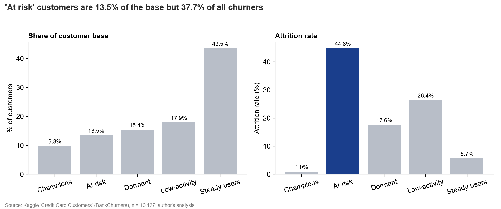

# Card Activation & Loyalty Analysis

**Business question.** A Polish retail bank (fictional client) sees many credit card holders who rarely use their cards or stop using them.
Which customer segments are inactive or at risk, what drives it, and what should the bank do to raise card usage?

📊 [Client deck (PDF)](outputs/card_activation_deck.pdf) · 📓 [Notebook](notebooks/analysis.ipynb) · 📗 [Excel workbook](outputs/segment_summary.xlsx)

---

## Executive summary

Out of 10,127 customers, 1,627 (16.1%) left the bank. Churn is concentrated, and the warning signs show up in data the bank already has.

**Findings**

1. **Falling card use is the clearest warning sign.** 61.8% of churned customers had cut their number of transactions by 40% or more (Q4 vs Q1), against 21.2% of retained customers. Customers whose transactions fell by more than 60% churned at **60.0%**, compared with **7.1%** for customers whose use stayed flat or grew.
2. **Inactivity raises attrition sharply.** Attrition rises from **4.5%** at 1 inactive month to **21.5%** at 3 months and **29.9%** at 4 months. 3,846 customers (38% of the base) sit at exactly 3 inactive months.
3. **Every contact with the bank adds risk.** Attrition is **1.8%** for customers with no contacts, **20.1%** with 3 contacts and **33.5%** with 5. All 54 customers with 6 contacts left.

Combined: customers with **3+ inactive months and 3+ contacts** are 22.9% of the base but **42.2% of all churners** (29.6% attrition vs 12.0% for everyone else).

**Recommendations**

| # | Action | Target | Metric to track |
|---|---|---|---|
| 1 | **Early-warning trigger**: flag customers at 3+ inactive months with falling transactions or 3+ contacts, and send a retention offer | "At risk" segment (1,367 customers, 44.8% attrition) and the flagged group (2,317 customers) | Attrition rate vs a control group |
| 2 | **Activation offer**: cashback for reaching a monthly transaction target for 3 months | "Low-activity" segment (1,815 customers, 26.4% attrition) | Transactions per active card, activation rate |
| 3 | **Service-contact review**: find the top contact reasons, give senior handling from the 3rd contact | Customers with 3+ contacts (5,002) | Attrition of 3+ contact customers, repeat-contact rate |

### Activity segments

| Segment | Customers | % of base | Avg spend ($) | Avg transactions | Attrition rate | % of all churners |
|---|---:|---:|---:|---:|---:|---:|
| Champions | 989 | 9.8% | 10,183 | 98.5 | 1.0% | 0.6% |
| At risk | 1,367 | 13.5% | 2,983 | 50.9 | **44.8%** | **37.7%** |
| Dormant | 1,555 | 15.4% | 1,504 | 32.8 | 17.6% | 16.8% |
| Low-activity | 1,815 | 17.9% | 2,651 | 53.1 | 26.4% | 29.5% |
| Steady users | 4,401 | 43.5% | 5,294 | 77.8 | 5.7% | 15.4% |



---

## Data & method

**Dataset.** Kaggle "[Credit Card Customers](https://www.kaggle.com/datasets/sakshigoyal7/credit-card-customers)" (`BankChurners.csv`, CC0 public domain): 10,127 customers, one row each, 12-month activity summary. Downloaded 2 Nov 2026.

**Data notes** (from [`sql/02_data_quality.sql`](sql/02_data_quality.sql)):
- 10,127 rows, 10,127 distinct `CLIENTNUM`: no duplicates.
- No NULL values in any column.
- `Unknown` values: Education_Level 1,519, Income_Category 1,112, Marital_Status 749. Kept as their own category (none of these columns is used to build the segments).
- No negative amounts. Utilization ranges 0 to 0.999. Age ranges 26 to 73.
- `Avg_Open_To_Buy` = `Credit_Limit − Total_Revolving_Bal` for every row (consistency check passed).
- Cleaning: dropped the two `Naive_Bayes_Classifier_...` columns (another model's predictions, not customer data). Nothing else needed cleaning.

**Segmentation (RFM-style)** in [`sql/03_segmentation.sql`](sql/03_segmentation.sql). The data has no last-purchase date, so:
- **R** (recency proxy) = months inactive in the last 12. Fixed bands: 4 = 0–1 months, 3 = 2, 2 = 3, 1 = 4+. Not `NTILE`, because 38% of customers have exactly 3 inactive months and `NTILE` would split identical customers into different scores.
- **F** = number of transactions, **M** = spend: `NTILE(4)` quartiles (4 = best).
- Rules, first match wins: **Champions** F=4 & M=4 & R≥3 → **At risk** R≤2 & Q4/Q1 transactions < 0.6 → **Dormant** F=1 & M=1 → **Low-activity** F+M ≤ 4 → **Steady users**.

**Drivers** in [`sql/04_drivers.sql`](sql/04_drivers.sql): attrition by months inactive, contacts, card tier, income, age band; Q4-vs-Q1 change for churned vs retained (with a median computed by window functions); utilization by segment. Card tier, income and age showed only small differences, so they are not headline findings.

**Tools.** SQL (SQLite: same queries run on PostgreSQL, see note below), Python (pandas, matplotlib), Excel (openpyxl), PowerPoint (python-pptx).

> **Why SQLite and not PostgreSQL?** PostgreSQL wasn't installed on the machine this was built on. SQLite needs no server and ships with Python. The queries use standard SQL (CTEs, `NTILE`, `ROW_NUMBER`, `SUM() OVER`). The one SQLite shortcut is `AVG(condition)` (a true/false condition counts as 1/0). In PostgreSQL write `AVG((condition)::int)`.

---

## How to run

```bash
pip install -r requirements.txt
python run_all.py                                            # SQL -> charts -> Excel -> deck
powershell -ExecutionPolicy Bypass -File src/export_pdf.ps1  # deck -> PDF (Windows + PowerPoint)
```

Or open `notebooks/analysis.ipynb` and run all cells.

```
card-activation-analysis/
├── data/raw/BankChurners.csv        # source data (CC0)
├── data/processed/                  # one CSV per SQL query + customers_with_segments.csv
├── sql/01..04_*.sql                 # all analysis logic
├── src/                             # run_sql.py, charts.py, excel.py, deck.py, export_pdf.ps1
├── notebooks/analysis.ipynb
├── outputs/                         # charts/, segment_summary.xlsx, card_activation_deck.pptx/.pdf
└── run_all.py
```

**Excel pivot table.** Python can't create a real Excel PivotTable, so the `Pivot` sheet has the same numbers as a static table plus 6 steps to build the PivotTable yourself (segment × card category, count and average spend).

---

## Limitations

- **Public, US-style data.** Income bands are in USD and the bank is not Polish; patterns would have to be checked on the client's own data.
- **No transaction dates.** "Recency" is approximated by months inactive; we can't see *when* in the year a customer stopped using the card or the exact churn date.
- **Snapshot, not a time series.** We can't prove that falling usage came *before* the decision to leave. Both may happen together during the exit.
- **Descriptive, not causal.** Contacts may be a symptom (a problem the customer already had), not a cause. Only a controlled test can show whether an action reduces churn.
- **Small groups.** 0 inactive months (29 customers), 6 contacts (54) and Platinum cards (20) are too small for firm conclusions.
